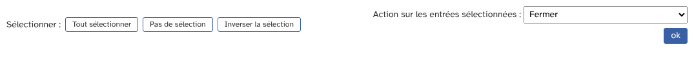
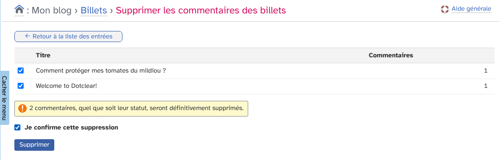

# postslistOptions : guide d'utilisation

postslistOptions ajoute des actions à la liste des billets (et à celle des pages) pour ouvrir, fermer ou supprimer en une fois les commentaires et les rétroliens de plusieurs billets.

## Table des matières

1. [Utiliser les actions](#utiliser-les-actions)
2. [Ouvrir ou fermer les commentaires et les rétroliens](#ouvrir-ou-fermer-les-commentaires-et-les-rétroliens)
3. [Supprimer tous les commentaires ou rétroliens](#supprimer-tous-les-commentaires-ou-rétroliens)
4. [Bon à savoir](#bon-à-savoir)

## Utiliser les actions

Le plugin n'a ni réglage, ni page d'administration. Ouvrez **Billets** (ou **Pages**), cochez un ou plusieurs billets, puis choisissez une action dans la liste « Action sur les entrées sélectionnées » et cliquez sur « ok ».

Deux nouveaux groupes sont ajoutés à la liste :

* **Commentaires** : Ouvrir, Fermer, Supprimer tous les commentaires.
* **Rétroliens** : Ouvrir, Fermer, Supprimer tous les rétroliens.

## Ouvrir ou fermer les commentaires et les rétroliens

« Ouvrir » et « Fermer » changent l'état des commentaires (ou des rétroliens) de tous les billets cochés : un visiteur ne peut plus commenter un billet dont les commentaires sont fermés, mais les commentaires existants restent affichés.

Un message confirme l'opération, par exemple « Commentaires fermés avec succès. ». Dotclear enregistre aussi la date de mise à jour de chaque billet modifié.

## Supprimer tous les commentaires ou rétroliens

Les actions « Supprimer tous les commentaires » et « Supprimer tous les rétroliens » passent par une page de confirmation. Elle liste les billets cochés avec leur nombre de commentaires (ou de rétroliens), et indique le total qui sera supprimé, quel que soit leur statut (publiés, en attente, indésirables…). Cochez « Je confirme cette suppression », puis cliquez sur « Supprimer ».

Les commentaires (ou rétroliens) sont alors supprimés et le compteur de chaque billet repasse à zéro. **Cette suppression est définitive.**

## Bon à savoir

* Contrôlez bien la liste et le total affichés sur la page de confirmation avant de supprimer : les commentaires indésirables et en attente sont supprimés aussi.
